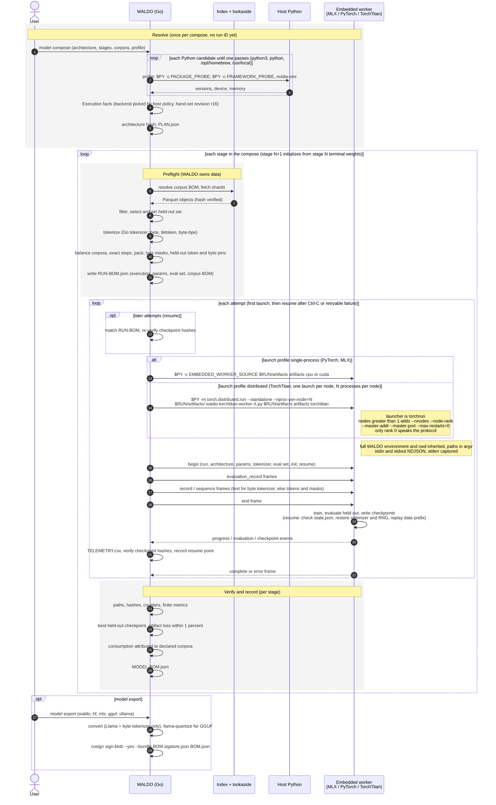
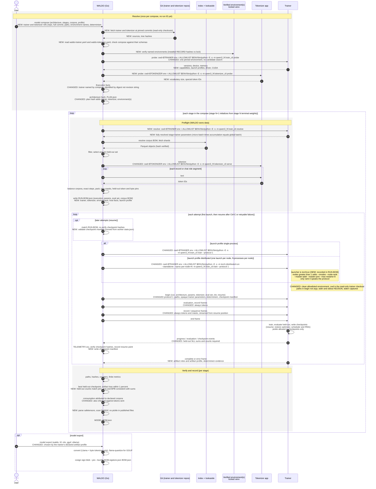

# ADR 0084: External trainers

Status: accepted
- Date: 2026-11-02

This ADR records the design of the external trainers proof of concept. Until
the implementation lands and the maintained contracts are updated, the
behavior described here is planned, not available.

## Context

Today the trainer is an interchangeable executor of a pinned recipe. ADR 0017
resolves the backend from host policy outside the compose, and the plan hash
covers architecture, recipe, and corpus facts, not the code that trained the
model. The BOM records only `backend {name, revision}` with a hand-bumped
revision label, a free-text runtime, the host, and accelerators. It records no
worker source hash, no WALDO binary digest, and no dependency lock. That is
sound only while WALDO writes every trainer itself and treats the built-in
worker as a constant.

Users want to bring their own training program: a different model family, a
different framework, or their own optimizer and parallelism. Once the trainer
is user supplied it is no longer a constant. Two runs with the same compose
and different trainer commits produce different models, so the trainer, its
tokenizer, and its environment become part of what the model *is*.

WALDO makes no byte-for-byte training-output claim today. The maintained docs
make byte-exact claims only for corpus objects, recipes, and export tensor
copies. ADR 0029's bit-identical resume gate is a conformance test for the
built-in MLX worker, not a published guarantee. External trainers keep that
boundary.

Held-out loss is per-token cross-entropy on a deterministic, pinned sample of
the training corpora excluded from training (ADR 0030, ADR 0080). It is used
for checkpoint selection (ADR 0079) and telemetry, not promotion (ADR 0075).

## Decision

A model compose may name an external trainer and an external tokenizer. Each
is a program pinned by git commit and run in a pinned environment. When
present, the trainer replaces the built-in worker and becomes part of the
model's identity and BOM. A compose without a `trainer` block behaves exactly
as today.

### 1. The trainer defines the model

The plan hash covers:

- trainer source: repository, full commit SHA, git tree hash, path, and
  manifest SHA-256;
- tokenizer source, with the same shape;
- each selected named environment: lock file hash and interpreter version;
- the resolved trainer and tokenizer configuration;
- the architecture; and
- the corpus BOMs.

Host facts (GPU, driver, CUDA, kernel, launch profile, launcher) go in the run
BOM only. They scope reproducibility claims but do not change the model's
identity.

Rationale: a model is what produced it. A commit SHA alone is not enough
because the path inside the repository and the manifest select what actually
runs, and the tree hash makes the checkout verifiable without trusting the
remote. Host facts change how fast and how exactly a run executes, not what
was asked for, so putting them in the plan would fork identity on every
hardware change.

### 2. WALDO owns data

WALDO owns selection, ordering, the held-out split, corpus balancing, token
budgets resolved to exact steps, packing, loss masks, and the resume position.
Trainers never read the index or Parquet. Trainers receive token IDs only;
there is no text mode.

Rationale: the corpus BOM, consumption accounting, held-out pins, and
contamination gates are WALDO's guarantees (ADR 0002, ADR 0018, ADR 0030,
ADR 0045). They hold for any trainer only if no trainer can change what data
it sees. Token IDs give WALDO one input representation to verify.

### 3. The tokenizer is a separate application

A tokenizer has its own manifest, `waldo-tokenizer.yaml`, with commands
`probe` and `serve`. WALDO drives it as a long-lived NDJSON codec for all
tokenization: training records, chat role segments, and held-out records. It
may share a repository and commit with the trainer.

Rationale: tokenization is part of data preparation, which WALDO owns, but
the vocabulary belongs to the model family. A separate process lets WALDO keep
tokenization in its pipeline (and its counts in its pins) while the model
author supplies the codec. Keeping it independent of the trainer process means
WALDO tokenizes before any training process starts, during preflight.

### 4. Trainer manifest

The trainer manifest is `waldo-trainer.yaml` at the trainer path. It declares
`kind`, `schema`, `name`, `protocol`, `entrypoint` (`module` or `script`;
`executable` is reserved for later), `commands` (`probe`, `resolve`,
`train`), `launch_profiles`, `objectives`, `artifact_profile`, `schemas`
(`architecture` and `parameters`, as JSON Schema), and named `environments`.
The PoC supports `kind: python-lock` environments.

Rationale: WALDO must validate a compose, launch the trainer, and interpret
its output before running any trainer code. A declarative manifest at a
pinned commit makes those facts part of the hashed source. JSON Schema lets
the trainer own its parameter vocabulary while WALDO still rejects invalid
composes before launch.

### 5. WALDO launches every process

For every command, WALDO sets `cwd` to the read-only trainer (or tokenizer)
checkout, starts from an empty environment plus a recorded allowlist
(`env -i`), and runs `$ENV/bin/python -E -s -m <module> <command>` or the
script path. Launch profiles are `single-process`, implemented in the PoC,
and `distributed`, defined as an interface only; `torchrun` is its first
launcher. Stdout carries protocol frames only. Stderr is captured.

Rationale: the built-in workers inherit the full WALDO environment and a
candidate-searched host Python (ADR 0020, ADR 0024). For a hashed external
trainer that would let unrecorded state (user site-packages, `PYTHONPATH`,
stray variables) change the run. A pinned interpreter in a verified
environment, isolated flags, and an allowlist make the recorded inputs the
whole input.

### 6. External trainer protocol version 1

External trainers speak protocol version 1 over stdin and stdout NDJSON.
The built-in workers' schema-1 protocol (ADR 0018) stays internal and is never
declared by an external trainer.

- `begin` carries paths (artifacts, checkpoints, scratch), WALDO-owned data
  parameters, the opaque resolved trainer parameters and architecture with
  their hashes, tokenizer facts, the evaluation set, initialization, resume
  state with its checkpoint manifest, and the determinism mode.
- The trainer emits `event` frames (`progress`, `log`, `checkpoint`, and
  `evaluation` with held-out NLL sums and counts), then one `complete` frame
  (artifacts with roles and the artifact profile, consumption per corpus,
  evaluations, the selected checkpoint, and environment evidence) or one
  `error` frame with an error class.

Rationale: the internal protocol carries built-in assumptions (text frames for
the byte tokenizer, paths in argv, worker-owned `state.json`) and changes with
worker revisions. A separately versioned public protocol can be stable for
third parties while the built-in one keeps evolving. NLL sums and counts,
rather than only a loss value, let WALDO check the reported metrics.

### 7. Compose schema 2

Schema-2 composes add top-level `trainer` and `tokenizer` blocks. Both carry
`source: {repository, commit, path}` and `environment`; the trainer adds
`determinism` and the tokenizer adds `configuration`. `architecture` is opaque
to WALDO and validated by the trainer's architecture schema. Each stage has a
`data` block, owned by WALDO (budget, sequence length,
`global_batch_sequences`, seed, shuffle, evaluation selection, checkpoint and
evaluation cadence), and a `trainer` block, opaque to WALDO, validated by the
trainer's parameter schema and completed by `resolve`. The trainer must verify
that micro-batch size times accumulation steps times world size equals the
global batch. YAML anchors and aliases are allowed; `yaml.v3` expands them
before decoding.

A compose without `trainer` and `tokenizer` blocks uses the built-in trainer
and tokenizer transparently.

Rationale: the split between `data` and `trainer` is the ownership line from
decision 2 written into the file format. `global_batch_sequences` stays on the
WALDO side because it fixes optimizer steps and therefore consumption
(ADR 0071). The trainer decides how to realize it on its hardware.

### 8. Resume is required

WALDO writes and validates a checkpoint manifest recording step, tokens,
consumption, identity hashes, and file roles, and streams data from the
recorded resume position. A conformance test compares an interrupted and
resumed run with an uninterrupted one.

Rationale: ADR 0029's guarantees (no silent optimizer reset, auditable
interruption, same run ID) must hold for any trainer. Moving the manifest from
the worker's `state.json` to WALDO means WALDO, not trainer code, decides
whether a checkpoint is compatible.

### 9. Pickle only in checkpoints

Pickle is allowed only in checkpoint files, which are private, hash-verified
resume state. It is never allowed in published or exported artifacts.
Trainers should load checkpoints with `weights_only=True`.

Rationale: optimizer and RNG state in common frameworks is pickled, and
forbidding it would make resume impractical. Checkpoints are written and read
by the same pinned trainer under hash verification. Published artifacts are
loaded by other people and tools, so they stay Safetensors.

### 10. WALDO verifies the trainer's output

WALDO checks that reported paths are under the artifacts directory, hashes and
sizes, monotonic counters, finite metrics, consumption against tokens sent,
held-out target-token and byte counts against the pins, loss and bits-per-byte
against the reported NLL sums, Safetensors headers, NaN and Inf in tensors,
and the absence of pickle in published files. Beyond those checks the
trainer's held-out metrics are trusted. There is no separate `evaluate`
command. ADR 0075 promotion gates are unchanged.

Rationale: WALDO can check everything it can derive from its own inputs
without re-running the model. A WALDO-side evaluator would need the trainer's
model code, which is exactly what is being made external. Promotion already
uses independent gates, so trusting the held-out metric affects checkpoint
selection only.

### 11. Objectives are unchanged

Objectives stay `causal-language-modeling` and
`assistant-response-modeling`. The objective controls which record kinds a
stage accepts, how records are rendered, and which tokens carry loss. Packing
is the same for both. New objectives and data types are future WALDO work.

Rationale: objectives are data semantics, which WALDO owns. A trainer declares
which objectives it supports; it cannot add one.

### 12. Reference trainer

The reference trainer lives in the WALDO repository at
`examples/trainers/qwen3-hf`. It trains Qwen3 from scratch with Hugging Face
Transformers. Trainer and tokenizer share one directory, and the tokenizer
files are committed.

Rationale: one maintained trainer exercises the whole contract, serves as the
conformance target, and shows third parties a complete working layout.

## Amendments to existing ADRs

These apply only when a compose has a `trainer` block. Every built-in contract
below still holds unchanged for composes without one.

- **ADR 0017** (backends resolved outside the compose). For external trainers
  the compose names the trainer, and the trainer is identified by source and
  environment digests, not a revision string. Host policy no longer chooses
  the trainer. It still describes the host, and host facts still go to the run
  BOM. The built-in trainer remains resolved from host policy with its
  revision label.
- **ADR 0018** (one worker protocol). External trainers use external protocol
  version 1, not the internal schema-1 worker protocol. Resolution of stage
  parameters moves to the trainer's `resolve` command for the opaque
  `trainer` block. WALDO still resolves and pins every data parameter, and
  framework code still never reads the index or Parquet.
- **ADR 0029** (resume from complete checkpoint bundles). The checkpoint
  manifest moves from the worker's `state.json` to a WALDO-written manifest.
  Compatibility is checked against trainer, tokenizer, and environment
  identity instead of the backend revision. Atomic directory commits, hash
  verification before handoff, same-run resume, and the interrupted
  classification still hold.
- **ADR 0044** (verify persisted training artifacts). The four-way loss
  comparison and the shared embedded model definition are built-in trainer
  requirements and are not imposed on external trainers. External trainers
  are verified as in decision 10. Selection of the best held-out checkpoint
  (ADR 0079) still applies.
- **ADR 0046** (tokenization in Go). With an external tokenizer, WALDO drives
  the tokenizer application instead of its Go codec. Workers still receive
  token IDs only. The Go tokenizers remain the built-in tokenizers.

## Process

The two diagrams use matching step labels. NEW and CHANGED mark differences
from WALDO `main` today.

### WALDO `main` today



### WALDO with external trainers



## Examples

These match the reference trainer at `examples/trainers/qwen3-hf`.

Trainer manifest:

```yaml
# examples/trainers/qwen3-hf/waldo-trainer.yaml
kind: waldo-trainer
schema: 1
name: qwen3-hf
protocol: [1]
entrypoint:
  module: qwen3_hf.train_cli
commands: [probe, resolve, train]
launch_profiles: [single-process, distributed]
objectives: [causal-language-modeling, assistant-response-modeling]
artifact_profile: hf-causal-lm
schemas:
  architecture: schemas/architecture.json
  parameters: schemas/parameters.json
environments:
  cpu:  { kind: python-lock, lock: env/cpu/pylock.toml,  python: "3.12" }
  cuda: { kind: python-lock, lock: env/cuda/pylock.toml, python: "3.12" }
```

Tokenizer manifest:

```yaml
# examples/trainers/qwen3-hf/waldo-tokenizer.yaml
kind: waldo-tokenizer
schema: 1
name: qwen3-tokenizer
protocol: [1]
entrypoint:
  module: qwen3_hf.tokenizer_cli
commands: [probe, serve]
schemas:
  configuration: schemas/tokenizer.json
environments:
  cpu: { kind: python-lock, lock: env/tokenizer/pylock.toml, python: "3.12" }
```

Schema-2 compose for Qwen3 from scratch:

```yaml
kind: waldo-model-compose
schema: 2
trainer:
  source: &qwen3
    repository: https://github.com/openwaldo/waldo
    commit: <full 40-hex SHA>
    path: examples/trainers/qwen3-hf
  environment: cuda
  determinism: best-effort
tokenizer:
  source: *qwen3                 # YAML alias: same repo, commit, path (yaml.v3 expands it)
  environment: cpu
  configuration:
    files: tokenizer/
architecture:                    # opaque to WALDO, validated by schemas/architecture.json
  vocab_size: 151936
  hidden_size: 768
  intermediate_size: 2048
  num_hidden_layers: 12
  num_attention_heads: 12
  num_key_value_heads: 4
  head_dim: 64
  max_position_embeddings: 2048
  rope_theta: 1000000
  rms_norm_eps: 1.0e-6
  tie_word_embeddings: true
  bos_token_id: 151643
  eos_token_id: 151645
stages:
  - name: pretrain
    type: pre-training
    objective: causal-language-modeling
    corpora: [core/common-pile/pressbooks, core/synthetic/tinystories-reference]
    data:                        # WALDO-owned
      tokens: 5600000000
      sequence_length: 2048
      global_batch_sequences: 256
      seed: 42
      evaluation_selection: indexed-sample-v1
      evaluation_fraction: 0.01
      checkpoint_every: 500
      evaluate_every: 500
    trainer:                     # opaque, validated by schemas/parameters.json, completed by resolve
      learning_rate: 0.0006
      weight_decay: 0.1
      adam_beta2: 0.95
      lr_scheduler_type: cosine
      warmup_steps: 1000
      max_grad_norm: 1.0
      per_device_train_batch_size: 16   # 16 x 4 accumulation x 4 GPUs = 256
      gradient_accumulation_steps: 4
      bf16: true
```

## Out of scope

The following are not part of the proof of concept. Each is tracked under the
external trainers follow-ups milestone:

- the `distributed` launch profile beyond its interface: torchrun launch,
  hostfile and Fuzzball multi-node discovery;
- `executable` (non-Python) entrypoints;
- OCI container environments and user-provided virtual environments for
  `python-lock` environments;
- enforcement of determinism modes and a `model reproduce` command, and with
  them any byte-for-byte training-output claim;
- artifact profiles and exports beyond the reference profile, and inference
  for external artifact profiles;
- tokenizer training through the tokenizer application (ADR 0077), tokenizer
  assets pinned by hash and fetched from their origin, and ownership of chat
  template rendering;
- new objectives and data types;
- a Python helper package for trainers and tokenizer applications; and
- moving the built-in trainers and tokenizers onto the external identity
  model.

## Consequences

- A model's identity names the exact program, tokenizer, and environment that
  produced it. Two composes that differ only in trainer commit are different
  models.
- WALDO's data guarantees (corpus BOM, held-out pins, consumption, loss masks)
  hold for any trainer because no trainer can see anything WALDO did not send.
- Third parties can train model families WALDO does not implement without
  changing WALDO.
- Trust shifts: WALDO verifies everything derivable from its own inputs and
  trusts the trainer's held-out metric for checkpoint selection only.
- Existing composes, runs, checkpoints, and BOMs without a `trainer` block
  keep their behavior and identity.
